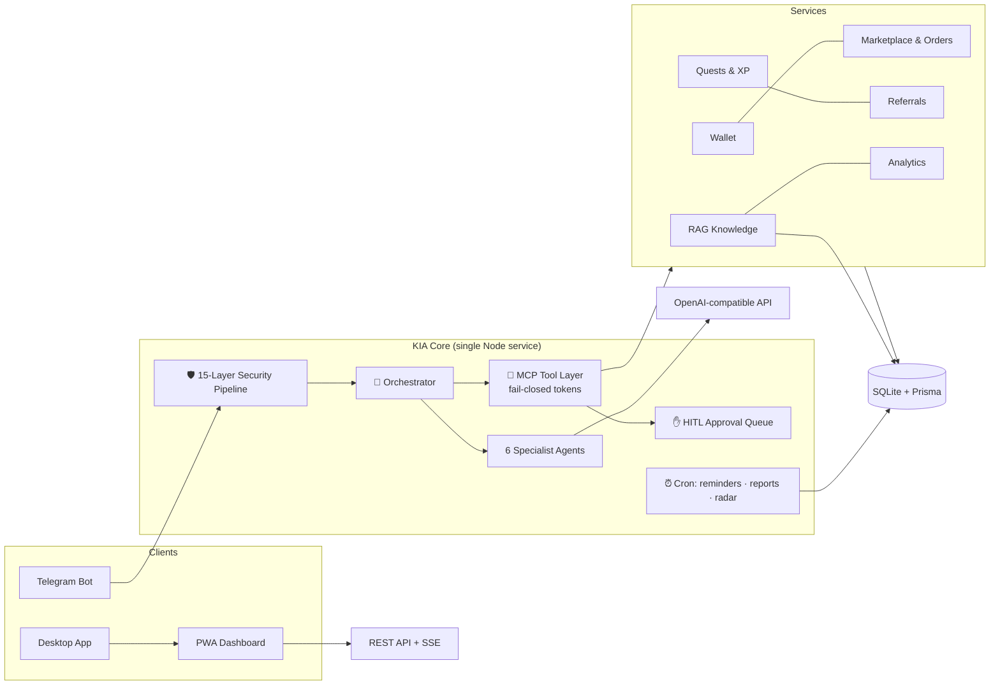

<div align="center">


# ⚡ KIA DropAgentX

### The Ultimate Telegram Super-App — AI Agents • Marketplace • Wallet • HITL Governance

**One deployable service. Three clients. Zero compromises.**

`Telegram Bot` · `Live PWA Dashboard` · `Native Desktop App`

[](#-development)
[](#-development)
[](LICENSE)
[](https://nodejs.org)
[](tsconfig.json)
[](#-deploy-to-railway-in-5-minutes)
[](CONTRIBUTING.md)
[](#)

[](https://railway.com/new/template?template=https://github.com/KiaAgentX/KIAdropAgentX)

[Features](#-features) · [Architecture](#-architecture) · [Quickstart](#-quickstart) · [Deploy](#-deploy-to-railway-in-5-minutes) · [Clients](#-three-clients-one-core) · [Security](#-security--15-layers-fail-closed) · [API](docs/API.md)

</div>

---

## 🌟 What is KIA DropAgentX?

**KIA DropAgentX** is a production-grade, self-hostable **Telegram business super-app** that fuses four products into one platform:

| Heritage | What it became in KIA |
|---|---|
| **DropAgentX** (body) | Wallet, marketplace, escrow orders, quests, referrals, leaderboards |
| **Zenovix** (brain) | 6 specialist AI agents, RAG knowledge base, HITL approvals |
| **Hermit** (hands) | Web research tools, scheduled jobs, competitor radar |
| **KIA-OS** (glue) | MCP-style fail-closed tool layer, A2A bridge, unified orchestrator |

> 💡 **Design philosophy:** *AI never touches money without a human.* Every high-risk
> action (withdrawals, refunds, broadcasts, spend over quota) is parked in a **HITL
> approval queue** and expires **fail-closed** if the owner doesn't decide in time.

Everything ships as **one Node.js service** — SQLite database included, zero external
infrastructure. Deploy it once and you instantly get a Telegram bot, a live web
dashboard and a desktop client, all backed by the same API and audit trail.

---

## ✨ Features

### 🤖 AI Agent Crew (6 specialists, 25 languages)
- 🧠 **Orchestrator** — security-gated intent routing (AI classifier + keyword fallback)
- 🛎️ **Receptionist** — greetings, FAQs, bookings; answers grounded in your knowledge base
- 💼 **Sales** — consultative qualification (need → budget → timeline → close), live catalog
- 🛟 **Support** — empathetic helpdesk; files refund requests for human approval
- 📊 **Analyst** — staff-only BI: snapshots, leaderboards, decision-ready insights
- ✍️ **Content Studio** — turns rough ideas into polished product listings
- Works with **any OpenAI-compatible API** (OpenAI, DeepSeek, GLM, OpenRouter, Ollama…) —
  and degrades to deterministic rule-based flows when the AI is offline

### 🛒 Marketplace & Money (integer math only)
- Products with Stars **and** credits pricing, categories, stock, featured slots, reviews
- **Escrow order lifecycle**: pending → paid → delivered → (disputed) → completed/refunded
- ⭐ Telegram Stars invoices + 💳 internal credits (dual currency)
- Wallet: deposit, transfer, **HITL-gated withdrawals**, full transaction history
- Coupons, quests & XP (daily/weekly/one-time), streaks, referral program, leaderboards
- Appointments/booking system with reminders

### 🎯 Lead CRM (import → dedupe → close)
- Import prospects as JSON (dashboard textarea, API or a `.json` file dropped in the bot chat)
- **Dedupe by normalized contact** (email / `+phone` / `@handle`) — duplicates are skipped, never fatal
- Pipeline `new → warm → won` (+ `lost`, revive `lost → warm`) with validated transitions
- Won-rate KPI, 24h velocity, stage chips and one-tap stage moves on the dashboard
- Bot commands: `/crm` stats · `/lead <contact> [name]` quick-add

### 🏷️ White-label in one env var
- `BRAND_NAME` / `BRAND_TAGLINE` / `BRAND_FOOTER` rebrand the **bot, dashboard and desktop** instantly
- Override live from the dashboard (`brand_*` settings) — no redeploy needed
- The PWA rebrands itself at boot from `GET /api/v1/brand`

### 🛡️ Governance & Security
- **HITL approval queue** with risk levels, TTL expiry and one-tap approve/reject
- **15-layer fail-closed security pipeline** (see [below](#-security--15-layers-fail-closed))
- MCP-style **tool layer** with signed tokens — agents can only do what their manifest allows
- Full **audit log** + secret **redaction** on every AI output

### 🌐 Multilingual (25 locales)
English, **فارسی**, العربية, Русский, 中文, Español, Français, Deutsch, Türkçe, हिन्दी,
Português, Indonesia, 日本語, 한국어, Italiano, Українська, Polski, Nederlands, Tiếng Việt,
ไทย, اردو, עברית, বাংলা, Kiswahili, Ελληνικά — with RTL awareness (fa/ar/ur/he).

### 📊 Live PWA Dashboard + Desktop
- Realtime KPIs, sales chart, orders feed via **SSE** (no refresh needed)
- Owner panel: approvals, broadcasts (HITL-gated), settings, kill-switch, audit log
- Installable **PWA** on any phone; native **Electron** app for Win/macOS/Linux with tray

---

## 🏗️ Architecture



**Event-driven:** services never call Telegram directly — they emit typed bus events
(`order_paid`, `approval_created`, …) that the bot, dashboard (SSE) and cron layers
subscribe to. Add a new channel without touching business logic.

**Fail-closed everywhere:** unknown tool → deny. Missing token → deny. Expired approval →
deny. AI offline → deterministic fallback. Secrets in AI output → redacted.

📖 Deep dive: [docs/ARCHITECTURE.md](docs/ARCHITECTURE.md) · API: [docs/API.md](docs/API.md)

---

## 🚀 Quickstart

> **Prereqs:** Node.js **≥ 20** (or Bun ≥ 1.1) and npm.

```bash
# 1 — Clone
git clone https://github.com/<you>/KIAdropAgentX.git
cd KIAdropagentx

# 2 — Install & provision (DB + demo seed)
npm install
cp .env.example .env          # then edit — see table below
npm run setup                 # prisma push + seed

# 3 — Run
npm run dev                   # dashboard on http://localhost:3000

# 4 — Add your bot token to .env → BOT_TOKEN=… → restart
#    🤖 Bot is live (long-polling in dev). Set PUBLIC_URL in prod for webhooks.
```

That's it — the platform boots in **web-only mode** without a bot token, and in
**full mode** once `BOT_TOKEN` is set. Database is a local SQLite file: `db/kia.db`.

### 🔑 Environment variables

| Variable | Required | Default | Description |
|---|:---:|---|---|
| `DATABASE_URL` | ✔ | `file:../db/kia.db` | SQLite path (relative to `prisma/`). Railway: keep + mount volume |
| `BOT_TOKEN` | – | – | From [@BotFather](https://t.me/BotFather). Empty = web-only mode |
| `BOT_USERNAME` | – | – | Bot handle without `@` (referral links) |
| `PUBLIC_URL` | – | – | Public HTTPS URL → enables **webhook** mode; empty = long-polling |
| `TELEGRAM_WEBHOOK_SECRET` | – | – | `openssl rand -hex 32` — authenticates webhook calls |
| `OWNER_IDS` | ✔ | – | Your Telegram numeric ID(s), comma-separated — full control |
| `ADMIN_IDS` | – | – | Extra staff IDs (approvals, products) |
| `WHITELIST_ONLY` | – | `false` | `true` → only staff + whitelisted users can use the bot |
| `MCP_TOKEN_SECRET` | ✔ | – | `openssl rand -hex 32` — signs fail-closed tool tokens |
| `DASHBOARD_KEY` | – | MCP secret | Owner key for web-dashboard admin API (`X-KIA-Key`) |
| `A2A_SECRET` | – | – | Enables the A2A JSON-RPC endpoint when set |
| `RATE_LIMIT_PER_MIN` | – | `30` | Messages per user per minute |
| `DAILY_SPEND_LIMIT` | – | `500000` | Non-owner daily spend cap (credits) |
| `APPROVAL_TTL_MIN` | – | `60` | Pending approvals auto-expire (fail-closed) |
| `AI_BASE_URL` / `AI_API_KEY` / `AI_MODEL` | – | OpenAI | Any OpenAI-compatible endpoint |
| `ENABLE_*` flags | – | `true` | Toggle marketplace / quests / referral / bookings / radar / reports |
| `REPORT_TZ` | – | `UTC` | Timezone for daily owner reports |

> 🔍 Find your Telegram ID with [@userinfobot](https://t.me/userinfobot).

---

## ☁️ Deploy to Railway in 5 minutes

The repo is **Railway-ready out of the box** (`railway.json` + `nixpacks.toml` + `Dockerfile` + healthcheck at `/healthz`).

### Step 1 — Push to GitHub
```bash
git init && git add -A && git commit -m "🚀 KIA DropAgentX Ultimate"
git branch -M main
git remote add origin https://github.com/<you>/KIAdropagentx.git
git push -u origin main
```

### Step 2 — Create the Railway service
1. Go to [railway.app](https://railway.app) → **New Project → Deploy from GitHub repo** → pick `KIAdropagentx`
2. Railway auto-detects Nixpacks: `npm install → npm run build → start` — no config needed

### Step 3 — Add a Volume (persistent SQLite)
Service → **Storage/Volumes** → mount at `/app/db` — your data survives deploys.

### Step 4 — Variables
Service → **Variables** → add (minimum viable set):

```
NODE_ENV=production
OWNER_IDS=<your-telegram-id>
MCP_TOKEN_SECRET=<openssl rand -hex 32>
TELEGRAM_WEBHOOK_SECRET=<openssl rand -hex 32>
BOT_TOKEN=<from BotFather>
BOT_USERNAME=<yourbot>
DASHBOARD_KEY=<openssl rand -hex 24>
```

### Step 5 — Go live
1. **Settings → Networking → Generate Domain** → e.g. `https://kiadropagentx.up.railway.app`
2. Copy that URL into the `PUBLIC_URL` variable → redeploy → the bot **auto-registers its Telegram webhook**
3. Open the URL → live dashboard 🎉 · Open Telegram → your bot is alive 🤖
4. `/start` in your bot → `/panel` as owner → you're in business

<details>
<summary><b>🐳 Other deployment paths</b></summary>

```bash
# Docker (any VPS)
docker build -t kiadropagentx .
docker run -p 3000:3000 -v $(pwd)/db:/app/db --env-file .env kiadropagentx
```
Railway template button & Fly.io/Vercel notes: see [docs/DEPLOYMENT.md](docs/DEPLOYMENT.md).
*(Serverless platforms like Vercel are not recommended — the bot needs a long-lived process.)*
</details>

---

## 🧑‍💻 Three Clients, One Core

| | Telegram Bot | Web Dashboard (PWA) | Desktop (Electron) |
|---|---|---|---|
| **Best for** | customers & daily ops | owner analytics & governance | always-on command center |
| **Highlights** | full super-app: market, wallet, quests, AI chat, approvals | realtime SSE KPIs, owner panel, audit log | tray, close-to-tray, native chrome |
| **Where** | `@YourBot` | `https://<your-app>` (installable) | `desktop/` folder |
| **Auth** | Telegram identity + RBAC | public stats + owner key (`X-KIA-Key`) | wraps the dashboard |

**Bot quick tour:** `/start` · `/menu` · `/market` · `/wallet` · `/orders` · `/quests` ·
`/leaderboard` · `/ref` · `/book` · `/lang` — and **owner-only**: `/panel` · `/approvals`
· `/broadcast <text>` · `/addproduct` · `/stats` · `/kill on|off`. Free text always
reaches the **AI crew** (or its deterministic fallback).

---

## 🔐 Security — 15 Layers, Fail-Closed

Every inbound message traverses the pipeline **in order**; the first `block` wins and
every decision is audited. Administrative money actions are additionally gated by HITL.

| # | Layer | What stops |
|---|---|---|
| L01 | Whitelist Gate | non-whitelisted users when `WHITELIST_ONLY=true` |
| L02 | Kill Switch | everything, instantly (`/kill on` or runtime flag) |
| L03 | Rate Limit | flooding (`RATE_LIMIT_PER_MIN`) |
| L04 | RBAC | role escalation, staff-only tools from user accounts |
| L05 | Input Sanitize | malformed/oversized input |
| L06 | Prompt Injection | “ignore previous instructions” attacks on the AI crew |
| L07 | Schema Validation | type-confused tool arguments |
| L08 | Webhook Signature | forged Telegram webhooks |
| L09 | Anti-Replay | duplicate/resent webhook deliveries |
| L10 | Spend Quota | runaway AI/spend beyond `DAILY_SPEND_LIMIT` |
| L11 | HITL Gate | money & irreversible actions without a human decision |
| L12 | Fail-Closed Tool Token | unsigned/expired MCP tool tokens |
| L13 | Output Redaction | secrets/tokens leaking through AI replies |
| L14 | Idempotency | double-spending via replayed operations |
| L15 | Audit Trail | silence — every decision lands in `AuditLog` |

Details & threat model: [docs/SECURITY.md](docs/SECURITY.md) · report vulnerabilities per
[SECURITY policy](#-security) (below).

---

## 🧱 Project Structure

```
KIAdropAgentX/
├── src/
│   ├── index.ts              # composition root: DB → MCP hooks → Web → Cron → Bot
│   ├── config.ts             # validated env (zod) — single source of truth
│   ├── types.ts              # shared domain types
│   ├── core/                 # ⚙️ platform primitives: db · bus · logger · crypto · ids · errors · json
│   ├── security/             # 🛡️ 15-layer fail-closed pipeline (rate-limit, tokens, redaction…)
│   ├── services/             # 💼 domain: wallet · market · orders · coupons · quests · referrals ·
│   │                         #    leaderboard · analytics · bookings · notifications · hitl · settings · crm
│   ├── agents/               # 🧠 orchestrator + 6 specialist AI agents
│   ├── ai/                   # OpenAI-compatible provider (+ offline fallback)
│   ├── bot/                  # grammY adapter: middlewares + command handlers
│   ├── web/                  # Express adapter: REST API + SSE + static dashboard + webhook
│   ├── mcp/                  # MCP tool layer + approval→execution hook
│   ├── rag/                  # knowledge base (chunking + retrieval)
│   ├── i18n/                 # engine (25 locale files live in /locales)
│   └── cron/                 # reminders, approval sweeper, daily reports, radar
├── public/                   # 📊 PWA dashboard (vanilla, zero-build)
├── desktop/                  # 🖥 Electron shell (Win/macOS/Linux)
├── locales/                  # 🌐 25 languages
├── tests/                    # 🧪 node:test suite (core · security · CRM logic · i18n)
├── prisma/                   # schema (19 models) — SQLite
├── scripts/                  # seed & maintenance
├── docs/                     # ARCHITECTURE · DEPLOYMENT · SECURITY · API · sales kit
└── .github/workflows/ci.yml  # typecheck + tests + build + secret-scan + boot smoke
```

---

## 🧪 Development

```bash
npm run dev          # tsx watch — bot + dashboard + cron, hot reload
npm run typecheck    # strict TypeScript (src + tests), zero errors expected
npm test             # node:test suite — crypto, security layers, CRM rules, i18n
npm run build        # tsc → dist/
npm run db:studio    # Prisma Studio GUI
npm run seed         # (re)seed demo data — idempotent
```

Add yourself to `OWNER_IDS` first — the owner panel, approvals and broadcasts are
staff-only by design.

---

## 🗺️ Roadmap

- [x] Core: wallet · marketplace · escrow orders · quests · referrals · bookings
- [x] AI crew with RAG grounding + offline fallback
- [x] 15-layer security + HITL approvals with TTL
- [x] MCP fail-closed tool layer + A2A endpoint
- [x] PWA dashboard (SSE realtime) + Desktop shell
- [x] 25 languages with RTL
- [x] Lead CRM with JSON import + dedupe
- [x] White-label branding (`BRAND_NAME`)
- [x] Test suite + CI secret-scan
- [ ] Postgres adapter (multi-node scale-out)
- [ ] Telegram Mini-App storefront
- [ ] Plugin SDK for third-party MCP tools
- [ ] Vector embeddings for KB (pluggable provider)

---

## 🤝 Contributing

PRs are welcome! Read [CONTRIBUTING.md](CONTRIBUTING.md) — in short: `npm run typecheck`
must pass, keep money integer, keep new tools behind the security pipeline and add
locales for user-facing strings.

## 🛡️ Security

Found a vulnerability? **Please do not open a public issue.** Follow the disclosure
process in [docs/SECURITY.md](docs/SECURITY.md).

## ⚖️ License

[MIT](LICENSE) © KIA DropAgentX contributors

<div align="center">
<sub>Built with 🧠 + 🛡️ + ⚡ — DropAgentX body · Zenovix brain · Hermit hands · KIA-OS glue</sub><br/>
<sub>⭐ Star this repo if it saved you a week of backend work</sub>
</div>
